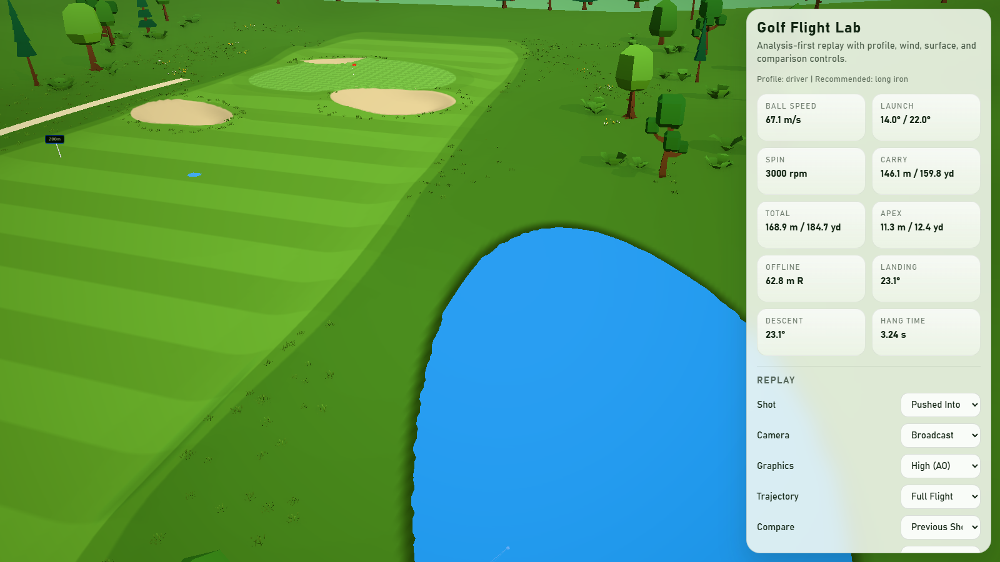

# Golf Flight Demo

Babylon.js + TypeScript + Vite demo for visualizing launch-monitor-style golf shots in a browser. The product goal is believable, stable shot analysis, not a full golf game.

## Screenshot



## Features

- Browser-based 3D hole with real relief (driving-zone dip, raised green plateau, valley sides, rough mounds, raised tee box), irregular bunkers, a pond, a cart path, tree lines, flag, tee markers, and distance markers
- Terrain-aware physics: the ball lands, bounces off slopes, and rolls downhill on the same terrain that is drawn
- Stylized "soft flat" look: every surface is a flat colour from one palette (`src/render/palette.ts`), shaped by lighting, soft shadows, and ambient occlusion
- Palette-painted terrain with crisp, antialiased edges that sit exactly on the physics surface boundaries, a first-cut collar, fairway mowing stripes, and a checkered green
- Low-poly CC0 trees, bushes, grass clumps, and wildflowers from the Kenney Nature Kit, recoloured from the palette
- Post-processing with MSAA, restrained bloom, Khronos PBR Neutral tone mapping, and SSAO (switchable in the panel), plus a gradient sky with low-poly clouds and backdrop hills
- Structured JSON shot input with centralized unit normalization to SI units
- Custom fixed-timestep ballistics with gravity, drag, Magnus-style lift and curve, spin decay, bounce, skid, and roll
- Calibration profiles for `driver`, `long_iron`, `short_iron`, `wedge`, and `putt_like`
- Environment and landing-surface response support for wind, altitude, dry/wet/normal ground, and fairway/rough/green/bunker rollout differences
- Analysis-first UI with camera modes, trajectory modes, comparison overlay, baseline shot selection, and live metrics
- Expanded sample bundle for stock, draw/fade, hook/slice, wedge, bullet driver, wind, wet/dry, and green-release scenarios

## Run

1. Install dependencies:

   ```bash
   npm install
   ```

2. Start the dev server:

   ```bash
   npm run dev
   ```

3. Build for production:

   ```bash
   npm run build
   ```

## Coordinate System

The simulation uses one explicit convention everywhere:

- `+Y` = up
- `+Z` = downrange / target line
- `+X` = golfer's right
- `launchAngle` = elevation above the horizontal plane
- `launchDirection` = horizontal start direction relative to target line
- Positive `sideSpin` / positive `spinAxis` = fade or slice toward `+X`

Backspin is attached to the local `-right` axis so lift remains upward even when the shot starts left or right of center.

## Shot Input

Shot input is JSON and supports optional unit declarations. If units are omitted, defaults are:

- speed: `mph`
- angle: `deg`
- spin: `rpm`

Example:

```json
{
  "name": "Custom Fade",
  "ballSpeed": 158,
  "launchAngle": 13,
  "launchDirection": 1.5,
  "backSpin": 2700,
  "sideSpin": 750,
  "clubType": "driver",
  "environment": {
    "windSpeed": 8,
    "windDirection": 12,
    "groundCondition": "dry"
  },
  "units": {
    "speed": "mph",
    "angle": "deg",
    "spin": "rpm"
  }
}
```

Primary shot fields:

- `ballSpeed`
- `launchAngle`
- `launchDirection`
- `backSpin`
- `sideSpin`
- `totalSpin`
- `spinAxis`

Optional extension fields:

- `clubType`
- `environment`
- `surfaceOverride`
- launch-monitor style secondary fields such as `clubPath`, `faceAngle`, `attackAngle`, `dynamicLoft`, and others

Optional values never block simulation.

## Physics Assumptions

- The aerodynamic model is a stable Magnus-style approximation, not a rigid-body spin-axis solver and not a vendor formula clone.
- Drag, backspin lift, sidespin curve, and spin decay all run inside a deterministic fixed timestep integrator.
- Wind is applied through relative air velocity, so drag and lift respond to the ball's speed through moving air rather than through the ground frame.
- Profile calibration is multiplicative. Each profile biases the same base coefficients instead of switching to an entirely different solver.
- If no `clubType` is supplied, the simulation still uses the driver profile by default and separately computes a recommended profile for analysis display.

## Terrain-Aware Ground

The ball lands, bounces, and rolls on the same terrain that is drawn (`src/core/collision.ts`). The simulation takes an optional `groundHeightResolver`; without one the ground is the flat `y = 0` plane and every rule reduces to the level-ground behaviour.

- The shot starts on top of the raised tee box. Apex is measured from that launch ground, so the tee height does not inflate it; carry and total stay horizontal distances.
- A landing splits the velocity along the ground normal: the normal part rebounds with the surface restitution and the part along the ground is damped. Balls kick off mounds and banks accordingly.
- On the ground, slopes pull the ball downhill (at 5/7 of gravity along the slope, as for a rolling sphere). The ball only comes to rest once the surface friction can hold it on the slope.
- The ground normal is estimated from the height field by central differences.

The hole has real relief: a dip in the driving zone, a climb to a raised green plateau, a valley whose sides rise to the tree lines, mounds in the rough, a raised tee box, bunkers with irregular outlines and built-up lips, and a pond right of the driving zone.

## Surface Model

Surface classification is shared by rendering and physics. The field currently resolves:

- `tee`
- `fairway`
- `rough`
- `green`
- `bunker`
- `fringe`
- `water` (the pond: the ball never bounces, is stopped within a few steps, and settles on the pond bed)

The cart path is decorative; the physics treats the ground under it as rough.

Each surface has its own configurable:

- restitution
- skid damping
- skid friction
- roll friction
- bounce threshold
- spin retention

Ground condition then applies another multiplier layer:

- `normal`
- `dry`
- `wet`

This keeps rollout differences simple but visible. The same launch landing on fairway, rough, green, or bunker will produce different post-landing behavior.

## Render Style

The scene uses a stylized "soft flat" look: flat palette colours, soft shadows, and ambient occlusion, with no photographic textures. The rendering is split into modules:

- `src/render/palette.ts`
  every scene colour as a named sRGB constant: surfaces, vegetation, sky, light, props, ball, and trajectory
- `src/render/terrain.ts`
  procedural hole layout, rolling height field, soft surface weights, and the surface classification thresholds shared with the physics
- `src/render/materials.ts` and `src/render/terrainStylePlugin.ts`
  a baked surface mask and tint map, painted in palette colours by a material plugin; each surface edge is drawn at the same weight the physics uses to classify it, so what the ball lands on matches what is shown
- `src/render/sky.ts`
  gradient sky dome with sun glow and a ring of low-poly clouds
- `src/render/assetLibrary.ts` and `src/render/vegetation.ts`
  glTF model loading (geometry only, recoloured with palette vertex colours) and placement of trees, bushes, grass, and flowers
- `src/render/courseDetails.ts`
  the pond's water surface and the cart path draped over the terrain
- `src/render/props.ts`
  flag, cup, tee markers, distance markers, and backdrop hills
- `src/render/postProcess.ts`
  MSAA, bloom, tone mapping, colour grading, and SSAO
- `src/render/scene.ts`
  scene orchestration, lighting, fog, shadows, cameras, and terrain-to-physics surface lookup

Vegetation loads asynchronously: the course renders immediately and the trees appear once their models arrive. If the models fail to load, the scene logs a warning and stays fully usable without them.

The ball uses a bright material with a fresnel rim and dimple normal detail so it stays readable against both sky and grass.

## Analysis UX

The panel is designed around rapid shot reading:

- camera modes: `broadcast`, `chase`, `dispersion`
- trajectory modes: `full`, `carry_only`, `roll_only`, `comparison`
- comparison sources: `previous` or `baseline`
- always-visible metrics:
  - ball speed
  - launch
  - spin
  - carry
  - total
  - apex
  - offline
  - landing angle
  - descent angle
  - hang time

The current shot is highlighted in warm colors. Comparison overlays render in a cooler color with a separate landing stack.

## Project Structure

- `src/types/shot.ts`: shot input, optional environment, and normalized data model
- `src/types/simulation.ts`: replay, comparison, session, calibration, and analysis result types
- `src/core/unitConversion.ts`: validation and unit normalization to SI
- `src/core/shotMapper.ts`: shot data to initial velocity and spin vectors
- `src/core/calibration.ts`: profile resolution, environment state building, and effective surface response
- `src/core/ballistics.ts`: deterministic fixed-timestep flight simulation
- `src/core/collision.ts`: bounce, skid, roll, and surface friction
- `src/core/physicsConfig.ts`: centralized tunable constants
- `src/render/palette.ts`: all scene colours
- `src/render/ballRenderer.ts`: ball mesh, rim-lit material, and shadow disc
- `src/render/terrain.ts`: procedural hole terrain (non-uniform grid, bunker bowls, green contour), surface lookup, and classification thresholds
- `src/render/materials.ts`: terrain surface mask and tint maps, and prop materials
- `src/render/terrainStylePlugin.ts`: material plugin that paints the terrain surfaces in palette colours
- `src/render/sky.ts`: sky dome and clouds
- `src/render/assetLibrary.ts`: glTF model loading and palette recolouring
- `src/render/vegetation.ts`: tree, bush, grass, and flower placement
- `src/render/courseDetails.ts`: pond water and cart path
- `src/render/props.ts`: pin, tee and distance markers, and backdrop hills
- `src/render/postProcess.ts`: post-processing pipeline and graphics quality switch
- `src/render/proceduralNoise.ts`: shared deterministic hash and noise helpers
- `src/render/scene.ts`: scene orchestration and camera control
- `src/render/trajectoryRenderer.ts`: current and comparison trajectory overlays
- `src/ui/debugPanel.ts`: DOM analysis panel and tuning controls
- `src/data/sampleShots.ts`: validation scenarios and comparison shots

## Performance Controls

The rendering path stays browser-friendly by design:

- terrain uses one procedural mesh with a non-uniform grid: sub-metre triangles around the tee and green complex, coarse triangles in the outskirts
- the terrain is painted from two baked lookup textures in a single StandardMaterial pass (see `src/render/terrainStylePlugin.ts`), so shadows, fog, and tone mapping stay on Babylon's built-in path; no tiled textures are loaded
- each vegetation model is merged into one mesh; trees and bushes render as instances with a per-copy tint, and only trees near the hole cast shadows
- grass clumps and flowers are thin instances: one draw call per model
- SSAO is the one expensive pass; the panel's Graphics select switches between "High (AO)" and "Standard" (no AO)
- the physics samples the terrain height function directly (a few lookups per step), not the rendered mesh, so ground contact costs no mesh queries

Model assets live in `public/models/` and are CC0 from the Kenney Nature Kit (see `public/models/LICENSE.md`).

The current largest browser cost is still the Babylon bundle size. Vite build passes, but the final chunk is large and can be code-split later if needed.

## Known Limitations

- Real launch monitor aerodynamic formulas are proprietary and are not reproduced here.
- Calibration profiles are tuned for believable differences, not vendor-validated yardages.
- Surface response is simplified and does not model turf penetration, spin loft, ball deformation, or moisture absorption in detail.
- Green behavior is approximated through friction and damping. Detailed check-and-release behavior would need a richer spin-ground model.
- The field is a single procedural hole demo, not a reusable course editor.
- The ground is a height field: no overhangs, and a ball on the ground stays glued to it rather than going airborne over a sharp crest.
- Ground contact uses the analytic height function; the rendered mesh interpolates it between vertices, so the two can differ by a few centimetres on steep features.
